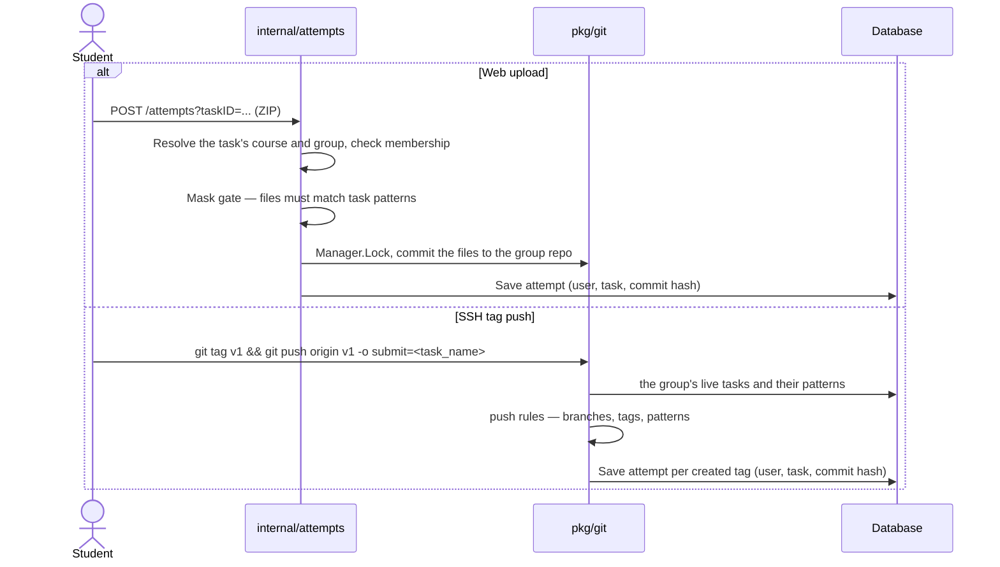

# Attempt API

## Overall description

This API allows course participants to create attempts for tasks within task groups.

### Attempt flow

There are two ways to create an attempt:

1. **Web interface** — upload a ZIP archive with solution files. The backend extracts the files, makes a commit in the group's git repository, and saves the attempt with the commit hash.

2. **SSH git tag push** — create a tag and push it with the `submit` push option naming the task (it may be left out when the group has one task):
   ```
   git tag submission-1 && git push origin submission-1 -o submit=<task_name>
   ```
   SSH pushes are handled entirely by `pkg/git` (see its README for the push rules): it reads the group's live tasks and saves an attempt for each created tag's commit through its `Store`, implemented by `internal/pg`. This module handles the web upload and reading attempts and diffs.

### Mask gate

A task may define file patterns (`patterns` in the data of its published block). A submission is rejected unless at least one of its files matches. Patterns live only in the database; both the SSH push rules and the web upload read them from there and match with the same `pkg/git.CompiledPatterns.MatchAny`. The web upload checks the uploaded files; a push checks the whole tree of the tagged commit.

### Database structure

An attempt (`attempts` table) links a user to a task (`tasks.id`) and has a chain of state transitions (`attempt_transitions` table). The transition data stores the commit hash from the git repository.

## Push Flow



## Key points

- One git repository per task group per student (all tasks share the same repo).
- Attempts are linked to individual tasks, not to the whole group.
- The commit hash is stored in `attempt_transitions.transition_data` as JSON.
- Both push methods write to the same repository.
- Web uploads and SSH sessions to one repository are serialized by `Manager.Lock`.
- Branch pushes never create attempts — only tag pushes do.
