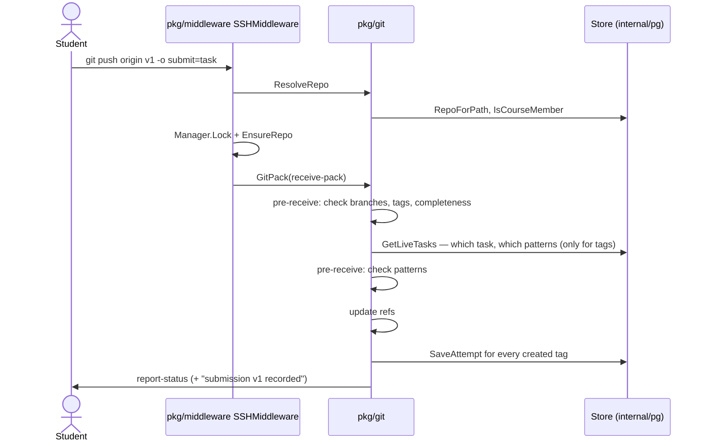
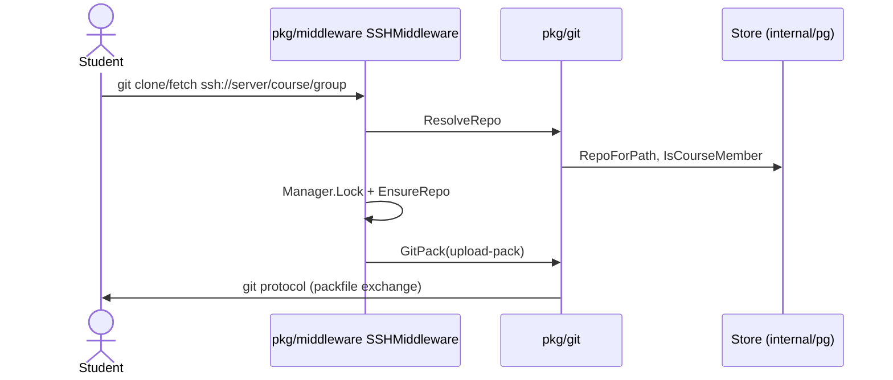

# Git server implementation

## Overall description

This package serves bare repositories over SSH with go-git's in-process `upload-pack` and `receive-pack` (`GitPack`), resolves and authorizes the repository an SSH path names (`ResolveRepo`), enforces the push rules of task submissions, and manages the repositories on disk (`Manager`: repository creation from a task group template, web commits, diffs, per-repository locking). It has no dependency on `internal/*`: what it needs from the database goes through `Store` (implemented by `internal/pg`), and `pkg/middleware.SSHMiddleware` runs the SSH session.

## Push rules

Checked in Go before any ref moves (`checkPush` in `git.go`, run as go-git's pre-receive hook); a refusal is reported to the client as `! [remote rejected] … (push rejected: …)`:

- Branches are never deleted, only move forward (no force-push) and must point to a commit.
- Tags are only created, never moved or deleted, and must point to a commit, directly or through an annotated tag.
- Every pushed commit must have all its objects (trees, blobs, parents) — go-git, unlike git, does not check a pushed pack for that (`checkConnected`, via `revlist.Objects`).
- Every created tag submits one task of the group's live tasks (`Store.GetLiveTasks`, read only when the push creates tags): the one named by `-o submit=<task>`, or the group's only task when the option is left out. More than one `submit` option, an unknown task, or `-o submit` without a new tag is refused.
- A submitted commit must contain a file matching one of the task's patterns (`CompiledPatterns.MatchAny`, the same check the web upload uses); a task without patterns accepts any commit.
- Nothing but branches and tags can be pushed.

After the refs moved, every created tag is saved as an attempt (`Store.SaveAttempt`, go-git's post-receive hook), and the client sees `remote: submission <tag> recorded` (or `was NOT recorded`).

## Use-cases

### git push

### git fetch

